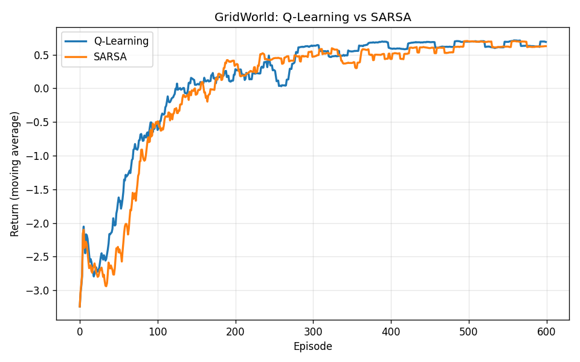
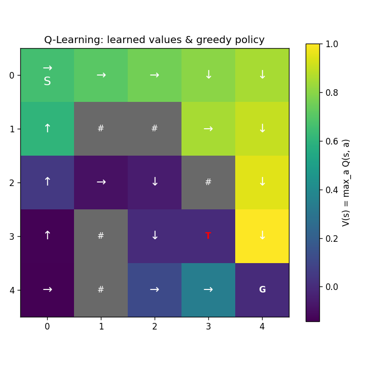
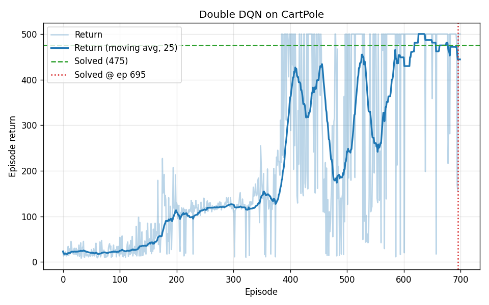

# Reinforcement Learning from Scratch: Tabular and Deep

[](https://www.python.org/)
[](https://pytorch.org/)
[](https://github.com/Igaspre/rl-from-scratch/actions/workflows/ci.yml)
[](LICENSE)

Implementations of the core value-based RL algorithms written from first
principles, with no `stable-baselines` or similar. The environments are also
written from scratch following the [Gymnasium](https://gymnasium.farama.org/)
`reset`/`step` API, so the whole repository runs on CPU with just NumPy,
Matplotlib and PyTorch.

It contains two projects:

| # | Project | Algorithm | Environment | Result |
|---|---------|-----------|-------------|--------|
| 1 | [Tabular Q-Learning and SARSA](docs/01_q_learning_gridworld.md) | Tabular TD control | `GridWorld` (custom) | Optimal trap-avoiding policy |
| 2 | [Deep Q-Network](docs/02_dqn_cartpole.md) | DQN + Double DQN | `CartPole` (custom physics) | Solved at episode 695; saved policy scores 500/500 |

## Highlights

- Two value-based families sharing one library. Q-Learning and SARSA differ by a
  single line (the bootstrap target); DQN and Double DQN differ by one block.
  The code keeps those differences explicit rather than hidden behind
  configuration.
- Environments built from scratch: a discrete `GridWorld` and a continuous
  `CartPole` with the standard cart-pole dynamics (semi-implicit Euler
  integration, same thresholds as the reference task). No RL framework
  dependency.
- An installable package with CLI training scripts, reproducible seeding, model
  checkpointing and a 27-test `pytest` suite that includes end-to-end learning
  checks.
- Every plot below is regenerated by the training scripts with a fixed seed.

## Results

### Project 1, GridWorld: Q-Learning vs SARSA

The agent must travel from `S` to the goal `G` while avoiding the trap `T`, on a
5x5 grid with walls (`#`). Both agents recover the optimal policy. The value
heatmap shows the value rising along the route the policy takes toward the goal,
and the arrows show that policy steering around the trap.

| Learning curves | Learned values and policy (Q-Learning) |
|---|---|
|  |  |

### Project 2, CartPole: Double DQN

Trained on the from-scratch CartPole. The agent reaches the maximum return of
500 and crosses the "solved" threshold (a 100-episode moving average of at least
475) at episode 695. Training keeps the best policy it evaluates rather than
whichever one the run happens to end on; at this seed that checkpoint comes from
episode 400, and it returns 500 in all 200 greedy episodes tested.

Those are two different episodes, and the gap is the point. The curve rises but
is nowhere near smooth, and the slump in the middle of it is the policy
genuinely getting worse rather than sampling noise. The
[write-up](docs/02_dqn_cartpole.md) separates the two and puts a number on each.



## Repository structure

```
.
├── rl/                          # The reusable library
│   ├── common/                  #   seeding + metric helpers
│   ├── envs/                    #   from-scratch environments
│   │   ├── gridworld.py         #     discrete GridWorld
│   │   └── cartpole.py          #     continuous CartPole (real dynamics)
│   ├── tabular/                 #   tabular agents
│   │   ├── agents.py            #     QLearningAgent, SarsaAgent
│   │   └── visualize.py         #     policy / value plots
│   └── deep/                    #   deep agents
│       ├── networks.py          #     MLP Q-network
│       ├── replay_buffer.py     #     experience replay
│       └── dqn.py               #     DQNAgent (+ Double DQN)
├── scripts/                     # CLI entry points
│   ├── train_gridworld.py
│   ├── train_dqn.py
│   └── evaluate_dqn.py
├── tests/                       # pytest suite (envs + agents)
├── docs/                        # per-project deep dives
├── assets/                      # generated plots
├── pyproject.toml
└── requirements.txt
```

## Installation

```bash
git clone https://github.com/Igaspre/rl-from-scratch.git
cd rl-from-scratch

python -m venv .venv
# Windows:  .venv\Scripts\activate
# macOS/Linux: source .venv/bin/activate

pip install -e .            # installs numpy, matplotlib, torch
# or: pip install -r requirements.txt
```

Everything runs on CPU. A GPU is not required.

## Quickstart

Project 1, tabular (seconds to run):

```bash
python scripts/train_gridworld.py --episodes 600 --seed 0
```

Project 2, deep (a couple of minutes on CPU):

```bash
# Train (Double DQN by default; use --no-double-dqn for vanilla DQN)
python scripts/train_dqn.py --episodes 700 --seed 0

# Evaluate the saved policy greedily
python scripts/evaluate_dqn.py --episodes 20
```

Run the tests:

```bash
pytest
```

## The algorithms, briefly

Q-Learning and SARSA both perform a one-step temporal-difference update
`Q(s,a) <- Q(s,a) + alpha * delta`. They differ only in the TD target:

- Q-Learning (off-policy): `delta = r + gamma * max_a' Q(s',a') - Q(s,a)`. It
  learns the greedy value regardless of the exploratory behaviour policy.
- SARSA (on-policy): `delta = r + gamma * Q(s',a') - Q(s,a)`, where `a'` is the
  action actually taken next. It learns the value of the policy it follows,
  which tends to be more conservative near hazards.

DQN scales value-based learning to continuous states with a neural network
`Q(s,a; theta)`, stabilised by two ideas:

- Experience replay: store transitions and sample random minibatches to break
  the temporal correlation that destabilises gradient updates.
- Target network: bootstrap against a periodically-frozen copy `theta-` to
  avoid chasing a moving target.

Double DQN addresses DQN's overestimation bias by decoupling action selection
(online network) from action evaluation (target network) in the TD target.

There is a fuller treatment in each project's write-up:
[Tabular](docs/01_q_learning_gridworld.md) and
[Deep](docs/02_dqn_cartpole.md).

## Design notes

- Why from scratch: implementing the environments and algorithms rather than
  calling a library shows the dynamics, the update rules and the engineering
  that keeps training stable.
- Reproducibility: `rl.common.set_global_seed` seeds Python, NumPy and PyTorch,
  and the environments accept a `seed` in `reset()`.
- Gymnasium-compatible API: environments return
  `(obs, reward, terminated, truncated, info)`, so swapping in a real Gymnasium
  environment is a one-line change.

## Possible extensions

Prioritised experience replay, dueling network architecture, n-step returns,
policy-gradient methods (REINFORCE, A2C, PPO), and `LunarLander` or Atari
environments.

## License

[MIT](LICENSE), 2026 Igaspre
