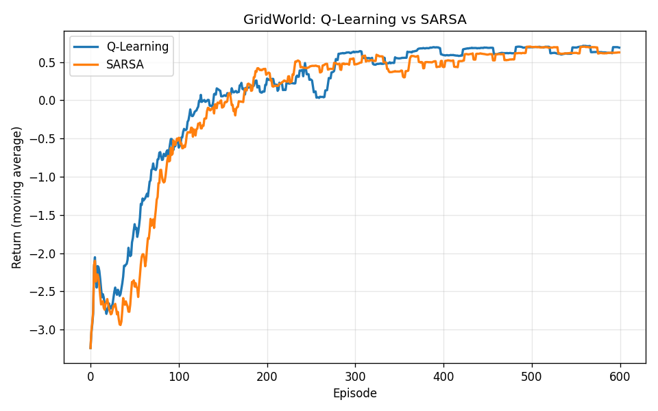
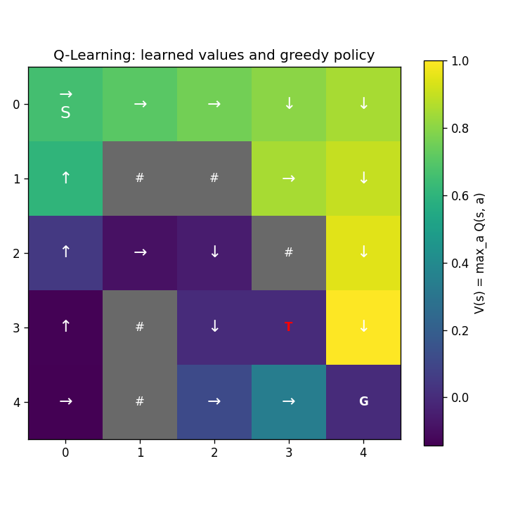

# Project 1: Tabular Q-Learning and SARSA on GridWorld

The "hello world" of Reinforcement Learning: a custom environment, two tabular
TD-control agents, and visualisations of the learned value function and policy.

## The environment

`GridWorld` ([`rl/envs/gridworld.py`](../rl/envs/gridworld.py)) is a small,
deterministic, fully-observable grid. Each cell is a discrete state; the agent
has four actions (up, right, down, left).

```
S . . . .       S  start
. # # . .       G  goal   (terminal, reward +1)
. . . # .       T  trap   (terminal, reward -1)
. # . T .       #  wall   (impassable)
. # . . G       .  free cell (step penalty -0.04)
```

A small negative reward on every step (a "living penalty") pushes the agent to
find short paths, and the trap sitting next to the goal makes the optimal policy
non-trivial: it must approach `G` from a direction that avoids `T`.

The environment follows the Gymnasium API:

```python
state, info = env.reset(seed=0)
state, reward, terminated, truncated, info = env.step(action)
```

## The agents

Both agents live in [`rl/tabular/agents.py`](../rl/tabular/agents.py) and share a
`TabularAgent` base class that owns the Q-table and the epsilon-greedy behaviour
policy (with random tie-breaking and per-episode epsilon decay). The only
difference is the temporal-difference target:

| | Type | TD target | Behaviour near the trap |
|---|---|---|---|
| Q-Learning | off-policy | `r + gamma * max_a' Q(s',a')` | learns the optimal (shortest) path |
| SARSA | on-policy | `r + gamma * Q(s',a')` | accounts for its own exploration, more cautious |

Because Q-Learning bootstraps from the greedy next action, it learns the optimal
value function independently of how much the agent explores. SARSA bootstraps
from the action it actually takes next, so while it is still exploring with
epsilon-greedy it learns a safer value function that gives the trap a wider
berth.

## How to run

```bash
python scripts/train_gridworld.py --episodes 600 --seed 0
```

Options: `--episodes`, `--seed`, `--smooth-window` (moving-average window for the
learning-curve plot).

This trains both agents and writes three figures to `assets/`:

- `gridworld_learning_curves.png`: smoothed return per episode for both agents.
- `gridworld_policy_qlearning.png`: value heatmap and greedy policy (Q-Learning).
- `gridworld_policy_sarsa.png`: value heatmap and greedy policy (SARSA).

## Results



Both agents converge to a positive greedy return of +0.72 (goal reward minus the
accumulated step penalties of the shortest safe path).



The heatmap is the state-value function `V(s) = max_a Q(s,a)`. Brighter cells are
worth more, and the value rises along the route the greedy policy takes toward
the goal. The arrows are that policy, which steers the agent around the trap `T`.

The terminal cells `G` and `T` stay at zero because they are only ever reached as
a next state, never used as the source of an update, so their row of the Q-table
is never written to. The dark cells in the bottom-left corner are simply far from
the goal along the policy's route.

## What this covers

- Implementing an MDP and the Bellman-based TD update from scratch.
- The distinction between on-policy and off-policy control.
- The exploration/exploitation trade-off via epsilon-greedy with decay.
- Turning a Q-table into an interpretable value and policy visualisation.
