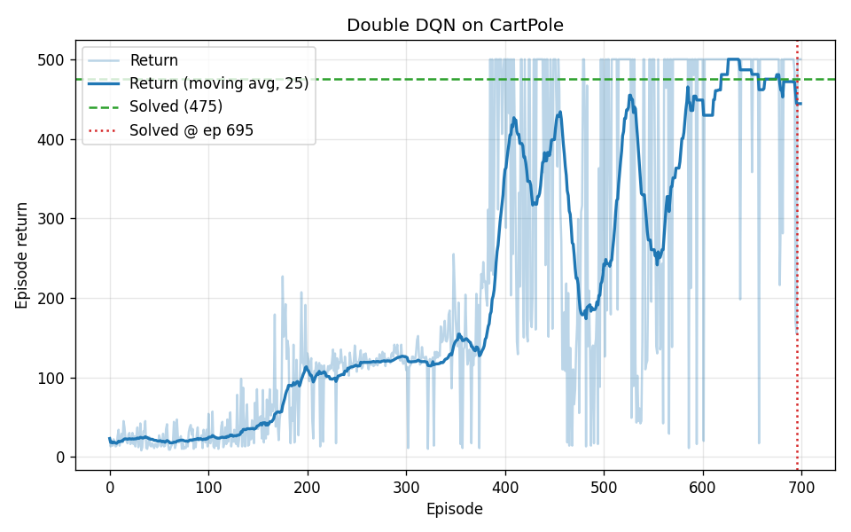

# Project 2 — Deep Q-Network (DQN / Double DQN) on CartPole

> Scaling value-based RL from a lookup table to a neural function approximator.
> A complete, from-scratch DQN — replay buffer, target network, Double DQN
> target, gradient clipping and Huber loss — that **solves** CartPole on CPU.

## The environment

`CartPoleEnv` ([`rl/envs/cartpole.py`](../rl/envs/cartpole.py)) re-implements the
classic cart-pole control task: balance a pole hinged on a cart by pushing the
cart left or right. The physics use the same equations of motion and
semi-implicit Euler integration as the reference Gymnasium environment, with
identical termination thresholds (±12° pole angle, ±2.4 cart position).

- **State** `(4,)`: cart position, cart velocity, pole angle, pole angular velocity.
- **Actions** (2): push left / push right.
- **Reward**: +1 per timestep the pole stays upright.
- **Episode**: terminates on failure, truncates at 500 steps. Max return = 500.

Because the dynamics match the canonical task, a policy trained here transfers
directly to `gymnasium.make("CartPole-v1")`.

## The agent

[`rl/deep/dqn.py`](../rl/deep/dqn.py) implements `DQNAgent`, combining the three
ingredients that make deep value-based RL stable:

1. **Q-network** ([`networks.py`](../rl/deep/networks.py)) — an MLP
   (`128→128→2`) that outputs the full action-value vector `Q(s,·)` in one
   forward pass.
2. **Experience replay** ([`replay_buffer.py`](../rl/deep/replay_buffer.py)) — a
   fixed-capacity ring buffer (NumPy-backed) that decorrelates the training
   minibatches.
3. **Target network** — a periodically-frozen copy of the Q-network used to
   compute bootstrap targets, removing the "moving target" instability.

Additional engineering details: ε is annealed linearly over the first 10k
environment steps, the loss is **Huber/SmoothL1** (robust to outliers), and
gradients are clipped by norm.

### DQN vs Double DQN

The TD target differs by which network evaluates the next action:

```
DQN         : y = r + γ · max_a'  Q_target(s', a')
Double DQN  : y = r + γ · Q_target(s', argmax_a' Q_online(s', a'))
```

Double DQN decouples action **selection** (online net) from action
**evaluation** (target net), which reduces the systematic overestimation of
Q-values that vanilla DQN suffers from. It is the default here; switch it off
with `--no-double-dqn`.

All hyper-parameters live in the `DQNConfig` dataclass, so an experiment is fully
described by a single object.

## How to run

```bash
# Train (Double DQN by default)
python scripts/train_dqn.py --episodes 700 --seed 0

# Vanilla DQN for comparison
python scripts/train_dqn.py --episodes 700 --seed 0 --no-double-dqn

# Evaluate the saved greedy policy
python scripts/evaluate_dqn.py --episodes 20
```

Training writes the model to `models/dqn_cartpole.pt` and the learning curve to
`assets/dqn_cartpole_returns.png`.

## Results



With `seed=0`, Double DQN:

- reaches the maximum episodic return of **500**,
- crosses the standard "solved" criterion — a 100-episode moving average ≥ 475 —
  at **episode 695**,
- and scores a perfect **500/500** averaged over 20 greedy evaluation episodes.

The curve shows the characteristic deep-RL signature: a slow start while the
replay buffer fills, rapid improvement, some instability (the dips), and final
convergence to the optimum.

## What this demonstrates

- Building DQN end-to-end in PyTorch, including the subtle bits (target masking
  on terminal transitions, `gather` for taken actions, target-network sync).
- Understanding *why* replay and target networks are necessary, not just *that*
  they are.
- The overestimation problem and the Double DQN fix.
- Practical training hygiene: reproducible seeds, checkpointing, evaluation
  separate from training, configurable hyper-parameters.
